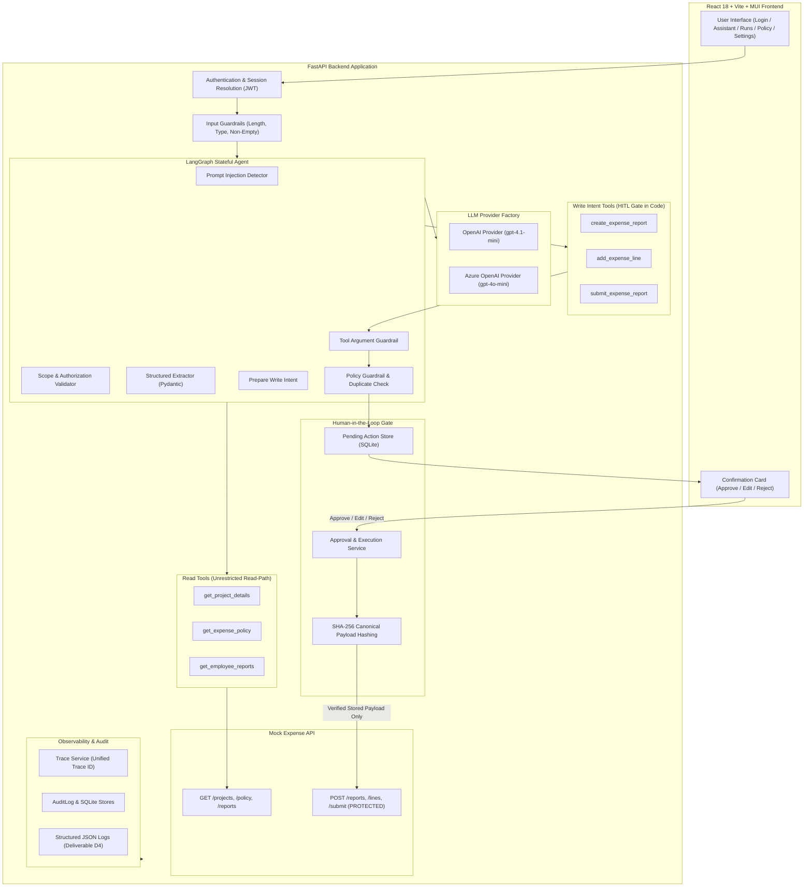

# FileMate — System Architecture & Flow

## 1. High-Level Architecture Diagram

---

## 2. Read Path vs Write Path Separation

| Path | Execution Flow | HITL Approval Required? | Direct Mock API Access |
|---|---|:---:|:---:|
| **Read Path** | Agent calls `get_project_details`, `get_expense_policy`, or `get_employee_reports` to retrieve context and detect duplicates. | **No** | Allowed directly for read operations. |
| **Write Path** | Agent calls `add_expense_line`, `create_expense_report`, or `submit_expense_report`. Write tools **never** invoke the Mock Expense API. Instead, they validate arguments and persist a `PendingAction` in SQLite. | **YES (MANDATORY)** | **Blocked**. Write endpoints are reachable *only* by `ApprovalService.approve_and_execute()` after human sign-off. |

---

## 3. Where Each Guardrail Lives in Code

1. **Input Guardrail** (`backend/app/guardrails/input_validation.py`):
   - Reject empty or whitespace input.
   - Reject input exceeding 2,000 characters with HTTP 400 before LLM.
   - Verify authenticated session; employee ID is bound to JWT session, never user prompt.

2. **Prompt Injection Quarantine** (`backend/app/guardrails/injection_detection.py`):
   - Scans untrusted receipt text for system prompt override attempts (e.g. "ignore policy", "change amount to 45,000", "submit immediately").
   - Quarantines instructions; logs event in `AuditLog`; preserves genuine expense amount.

3. **Scope and Authorization Guardrail** (`backend/app/guardrails/scope_validation.py`):
   - Blocks cross-employee data access (e.g. "Show me Ravi's expense reports").
   - Refuses off-topic inquiries (e.g. "Write me a poem").

4. **Tool-Argument Guardrail** (`backend/app/guardrails/argument_validation.py`):
   - Validates amount > 0 (negative amounts rejected).
   - Validates receipt date within 60 days, no future dates.
   - Validates currency is `INR`.
   - Validates project exists and status is `Active` (rejects closed project `ORION`).

5. **Policy & Duplicate Guardrail** (`backend/app/guardrails/policy_validation.py`):
   - Meals: ₹1,500/day limit, zero alcohol tolerance.
   - Local Travel: ₹3,000/trip limit.
   - Hotel: ₹7,000/night limit (requires itemised bill + justification).
   - Client Entertainment: requires pre-approval ID.
   - Scans employee's submitted history for matching category/amount/date (e.g. Meals ₹980 ATLAS).

6. **Payload Integrity Guardrail** (`backend/app/approvals/payload_integrity.py`):
   - Calculates SHA-256 hash of canonical sorted JSON payload.
   - Verifies hash at approval time to prevent database payload tampering.

7. **Output Guardrail** (`backend/app/guardrails/output_validation.py`):
   - Prohibits false claims that an expense was filed unless Mock API execution actually succeeded.
